Hey, I'm **Gabriel** from Brazil. I build with Claude Code every day, automate whatever bores me, and I'm already counting the days until GTA VI. E aí, bora? 🌴

## 🌆 What I'm up to

- 🤖 Building **AI agents** and **MCP servers** in Node.js. I like agents that ask before they act, so my Slack bots come with a human approval gate.
- 🧮 Automating spreadsheets and data chores with Google Sheets, Excel and Power Automate. If I did it twice, a script does it next time.
- 📊 About 3 years working with people analytics and data (Python/Pandas, SQL, BigQuery), now studying Psychology and Systems Analysis.
- 🛠️ Making personal tools and games for fun: a local assistant called Iris, themes for Claude Code, small browser games.
- 🐳 Putting things in Docker so they run on my machine *and* yours.

## ⚡ Skills

Also: JavaScript (freeCodeCamp certified, 2024) and a bit of PHP and R.

## 🚗 Things I made

The public garage (the good stuff is parked in private, ask me for a tour):

| Repo | The pitch |
| --- | --- |
| [todo-vibes](https://github.com/Biacchi/todo-vibes) | A to-do app built with Windsurf AI. Vibes included, procrastination sold separately. |
| [React-starter](https://github.com/Biacchi/React-starter) | Where every React adventure begins. |
| [Docker-Cloud-Functions](https://github.com/Biacchi/Docker-Cloud-Functions) | Cloud functions in a box. Works on my machine, and yours. |
| [Psych-Therapies-Help](https://github.com/Biacchi/Psych-Therapies-Help) | Psychology meets code. Yes, the two majors do talk to each other. |
| [Space-missions](https://github.com/Biacchi/Space-missions) | Houston, we have a dataset. |
| [streamlit-finance-app](https://github.com/Biacchi/streamlit-finance-app) | Because spreadsheets deserve a glow-up. |
| [Harry-Potter-API-Jupyter-Notebook](https://github.com/Biacchi/Harry-Potter-API-Jupyter-Notebook) | Wingardium Leviosa, but for API calls. |
| [Kaggle-exercises](https://github.com/Biacchi/Kaggle-exercises) | Homework, but with leaderboards. |
| [R-fake-clinical-trial](https://github.com/Biacchi/R-fake-clinical-trial) | 100% fake patients, 0% side effects. |
| [Woodstock-1969-Dataset](https://github.com/Biacchi/Woodstock-1969-Dataset) | Peace, love and clean columns. |
| [hr-analytics](https://github.com/Biacchi/hr-analytics) | A basic HR analytics notebook. People are numbers too (kidding, mostly). |
| [dummy-data](https://github.com/Biacchi/dummy-data) | Fake data for real experiments. |
| [OOP-Login-System](https://github.com/Biacchi/OOP-Login-System) | A simple PHP login system. Please do not use it for your bank. |
| [email-automation](https://github.com/Biacchi/email-automation) | A Python script that sends many emails so I don't have to. |
| [my-first-php-crud](https://github.com/Biacchi/my-first-php-crud) | My very first CRUD. We all start somewhere. |

**Private, ask me for a tour:** a Slack bot with a human approval gate and read-only MCP tools, a local assistant (Iris), and a pack of Claude Code themes.

## 🛹 Fun facts

- 🛹 I skate. The tests pass faster when I land the trick first.
- 🎸 I play guitar. Skate for the legs, guitar for the soul.
- 🎓 CS50x (Harvard, 2022) is what got me into tech. Thanks, David!
- 🌴 GTA VI hype level: **unreasonable**. See the banner. Vice City, I'm coming, tá ligado?

## 🐍 Contribution snake

<picture>
  <source media="(prefers-color-scheme: dark)" srcset="https://raw.githubusercontent.com/Biacchi/Biacchi/output/snake-dark.svg">
  <source media="(prefers-color-scheme: light)" srcset="https://raw.githubusercontent.com/Biacchi/Biacchi/output/snake.svg">
  
</picture>

